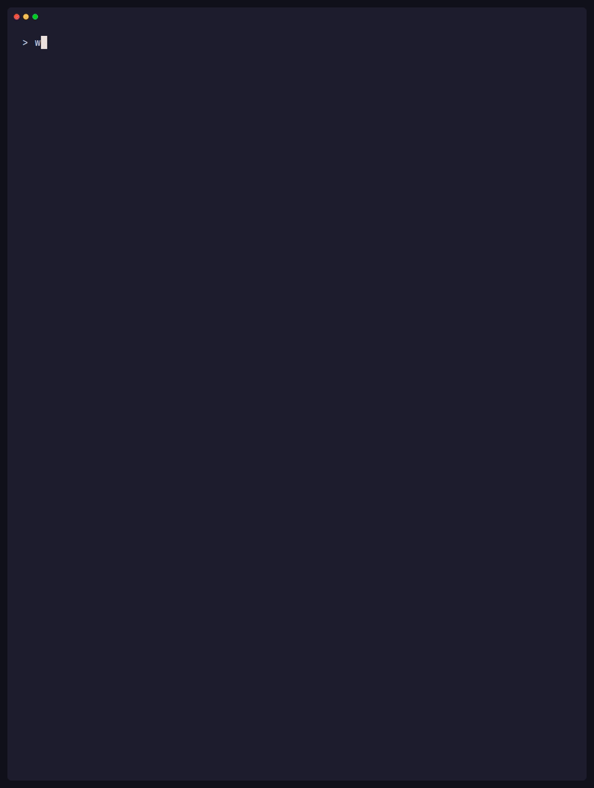

# weeklog

weeklog is a CLI that reads a week of work from pluggable sources, links that activity into units of work, and writes a Markdown log.



`docs/demo.tape` records `weeklog week --week 2026-W41` against that fixture. It uses no tokens and no personal activity. From the repository root, regenerate the GIF with [VHS](https://github.com/charmbracelet/vhs), plus `ttyd` and `ffmpeg` on `PATH`:

```bash
vhs docs/demo.tape
```

## Quickstart

Requires Go 1.23 or newer. From a checkout of this repository:

```bash
go install ./cmd/weeklog
export PATH="$(go env GOPATH)/bin:$PATH"
weeklog init
weeklog config check
weeklog sources
weeklog collect
weeklog week --md
```

`go install` writes the binary to `$(go env GOPATH)/bin`. A development build prints `weeklog version dev`. Release builds inject the version at link time:

```bash
go build -ldflags "-X main.version=v0.1.0" -o weeklog ./cmd/weeklog
```

`weeklog init` writes `$XDG_CONFIG_HOME/weeklog/config.toml`, or `~/.config/weeklog/config.toml` when `XDG_CONFIG_HOME` is unset. macOS uses `~/.config` when that variable is unset. `--config` selects another file. The file is the only one init writes.

On a terminal, init opens a form for sources (including Cursor Cloud), literal tokens, and the output dir and mode. `--no-input` skips it. An existing file is left unchanged unless you confirm, or unless `--force` is set when the form is skipped. Without a terminal, init enables a source only when it can find it:

| Source | Enabled when |
|---|---|
| git | `~/Projects` contains a repository within three directory levels |
| claude-code | `$CLAUDE_CONFIG_DIR` is a directory, or `~/.claude` when that variable is unset |
| codex | `$CODEX_HOME` is a directory, or `~/.codex` when that variable is unset |
| github | `gh` is on `PATH`, `gh auth status` succeeds, and `gh auth token` prints a token |

The file is mode 0600. GitHub uses `token = "cmd:gh auth token"`. Linear and Cursor cloud agents are not detected. The file includes a commented block for each: paste your key into `token`. A Cursor token is one literal value. See [Linear](#linear) and [Cursor](#cursor). A hand-written file has the same shape:

```toml
[identity]
emails = ["you@example.com"]
timezone = "America/Chicago"
week_starts = "monday"

[output]
dir = "~/journal/weeklog"
mode = "both" # both, file, or terminal

[[source]]
type = "git"
roots = ["~/Projects"]
authors = ["you@example.com"]

[[source]]
type = "claude-code"
```

`config check` reports whether each secret reference resolved and does not print the value. `sources` lists built-in collectors and plugins after a protocol `describe` check. `collect` reads the previous full week in the configured timezone, stores the events, and runs the linker. `week` prints a boxed recap on a terminal. When `output.dir` is set and stdout is a terminal, the default `output.mode` of `both` also writes `<output.dir>/<year>-W<week>.md` and prints a dim line naming that file. `--save` writes that file when `output.dir` is unset, at `~/.weeklog/weeks/<year>-W<week>.md`, and also when `output.mode` is `terminal`. The file is replaced on the next run. An existing file is not skipped. Text between `<!-- weeklog:notes -->` markers is kept.

`--week 2026-W41` selects an ISO week on both `collect` and `week`. `weeklog week --out -` prints the report to standard output: a boxed recap on a terminal, and Markdown when the output is a pipe, when `NO_COLOR` is set, or when `--plain` is set. `output.mode` is `both`, `file`, or `terminal`. `weeklog week --json` prints the same report as JSON.

## Config

weeklog reads `$XDG_CONFIG_HOME/weeklog/config.toml`, or `~/.config/weeklog/config.toml` when `XDG_CONFIG_HOME` is unset. `--config` selects another file.

```bash
weeklog config check
weeklog config check --config ./config.toml
```

`config check` accepts a literal secret and resolves optional `env:`, `cmd:`, and `file:` references. It reports whether each one resolved and does not print secret values. On Unix it warns when `config.toml` is group- or world-readable. See [docs/CONFIG.md](docs/CONFIG.md).

## Sources

Built-in sources are compiled into the binary. An external plugin is an executable named `weeklog-source-<name>` on `PATH` or in the plugin directory (`$XDG_DATA_HOME/weeklog/plugins`, or `~/.local/share/weeklog/plugins`).

| Source | What it reads | Setup |
|---|---|---|
| `git` | commits under `roots` | [Git](#git) |
| `claude-code` | local Claude Code transcripts | [Claude Code](#claude-code) |
| `codex` | local Codex rollout files | [Codex](#codex) |
| `github` | pull requests, reviews, and issues | [GitHub](#github) |
| `linear` | issues and state history | [Linear](#linear) |
| `cursor-cloud` | Cloud Agent runs | [Cursor](#cursor) |

The protocol is [docs/PLUGIN_PROTOCOL.md](docs/PLUGIN_PROTOCOL.md). `examples/weeklog-source-todoist` is a Python program that speaks the same protocol. It is an example, not a supported source. Copy `weeklog-source-todoist` onto `PATH` and configure a `todoist` source with a `token`. See [examples/weeklog-source-todoist/README.md](examples/weeklog-source-todoist/README.md).

```bash
weeklog sources
weeklog doctor
```

`doctor` checks paths, permissions, and that each plugin speaks protocol v1. It does not print or resolve secrets.

## Git

`git` collects commits from repositories under `roots`. init sets `roots` to `["~/Projects"]` and `authors` to `git config --global user.email` when that value has no spaces. Each root is scanned through three directory levels. `authors` matches author emails or names. When `authors` is omitted, collect uses `identity.emails`.

The collector runs `git log`. It does not contact the remote. A remote URL is stored as `host/owner/name`.

```bash
weeklog collect --source git
```

## Claude Code

`claude-code` reads `$CLAUDE_CONFIG_DIR/projects`, or `~/.claude/projects` when that variable is unset. Use Claude Code at least once so it writes a session. No token is required. The source table accepts no keys besides `type`.

The on-disk format is not a public schema. The parser keeps the fields it understands and skips lines it does not. Sub-agent files fold into the parent session.

```bash
weeklog collect --source claude-code
```

## Codex

`codex` collects agent sessions from Codex rollout files on the local machine.

### Prerequisites

Use Codex at least once so it writes a session. The collector reads `$CODEX_HOME` when that variable is set, and `~/.codex` otherwise. A leading `~` in `CODEX_HOME` is expanded. `~user` paths are not supported. No token is required.

### Config

```toml
[[source]]
type = "codex"
```

The `codex` source table accepts no keys. `roots`, `token`, and any other source key are unknown fields.

Collect reads `sessions/YYYY/MM/DD/rollout-*.jsonl` under that directory. Other files, including `history.jsonl`, are left unread. Each rollout file is one `agent_session`. The session id is the `id` in `session_meta`, then `session_id`, then the id in the filename. The window includes `since` and excludes `until`, compared to the session start. The start is the `session_meta` timestamp when it can be parsed, and otherwise the earliest line timestamp. The cursor records each file's size and modification time. A file whose fingerprint still matches is read again only when its session start lies in the requested window.

### Sessions

The on-disk format is not a public schema. The parser keeps the fields it understands and skips lines it does not. A line that is not a JSON object is counted and skipped. The session is still emitted.

A session event uses:

- **Title and summary.** The first user prompt. That is an `event_msg` of type `user_message`, or a `response_item` message with role `user`, whichever appears first. Developer and assistant text are not the title. The title is the first line, at most 200 characters. The summary is the prompt, at most 500 characters.
- **Working directory and branch.** `cwd` and `git.branch` from `session_meta`. A later `turn_context` supplies `cwd` only when `session_meta` did not.
- **Repository.** `git.repository_url` from `session_meta`, normalized to `host/owner/name`. Userinfo in the URL is removed, so a token in the URL is not stored. `git@github.com:owner/repo.git` becomes `github.com/owner/repo`.
- **Files.** Paths from `apply_patch` function calls and custom tool calls (`*** Add File:`, `*** Update File:`, `*** Delete File:`, and `*** Move to:`), and the file keys on an `event_msg` of type `patch_apply_end`. Paths under `cwd` are stored relative to it. Shell and `exec_command` text is not treated as a file list.
- **Tokens.** The latest `token_count` event's `total_token_usage`. `input_tokens` is `tokens_in`. `output_tokens` is `tokens_out`. Cached input is already included in `input_tokens` and is not added again.
- **body_ref.** A `file://` URL of the rollout file. The file is not copied.

A session with no timestamp is skipped. A rollout with no `session_meta` id still uses the filename id.

### Verify

```bash
weeklog config check
weeklog collect --source codex
```

`config check` prints the source block and no secret line, because codex has no secret fields:

```text
source[0] codex
ok
```

The index is the source's position in the file.

`weeklog collect --source codex` collects the previous full week, stores the events, and runs the linker. Success includes:

```text
source[0] codex: ok (2 events)
link: ok
```

The count is the sessions whose start falls in the window. `--week 2026-W41` selects an ISO week. The type name is case-sensitive. A missing Codex home is not a failure. Collect warns and reports zero events:

```text
source[0] codex: warn: codex home not found: /home/you/.codex
source[0] codex: ok (0 events)
link: ok
```

One unreadable line prints `source[N] codex: warn: skipped 1 unreadable session line`, and the ok line includes `, 1 dropped`. One session with no timestamp prints `source[N] codex: warn: skipped 1 session with no timestamp`. Counts above one use the plural.

### Common errors

`weeklog config check` exits 1 and collect does not start when the file has an error:

| Message | Cause |
|---|---|
| `error: source[N].token: unknown field for codex` | Any source key other than `type`, including `token` and `roots`. |

`weeklog collect --source codex` exits before collection with `source codex is not configured` when that block is missing.

A collector failure is one line, and the other sources still run. The command exits 1:

```text
source[0] codex: failed (codex: collect: expand "~nobody/codex": ~user paths are not supported)
```

| Message inside `failed` | Cause |
|---|---|
| `codex: collect: expand "~nobody/codex": ~user paths are not supported` | `CODEX_HOME` is a `~user` path. |
| `codex: collect: cannot find home directory: ...` | `CODEX_HOME` is unset and the home directory cannot be resolved. |
| `codex: collect: cannot read codex home: PATH` | The Codex home exists but cannot be read. |
| `codex: collect: cannot read sessions: PATH` | `sessions` exists but cannot be read. |

These are warnings. Collect still succeeds:

| Message | Cause |
|---|---|
| `codex home not found: PATH` | `$CODEX_HOME`, or `~/.codex`, is missing. |
| `codex home is not a directory: PATH` | That path is a file. |
| `sessions directory not found: PATH` | The Codex home has no `sessions` directory. |
| `sessions path is not a directory: PATH` | `sessions` is a file. |
| `cannot read sessions: PATH` | A year or month directory under `sessions` cannot be read. |
| `cannot read day: PATH` | One day directory cannot be read. |
| `cannot read session: PATH` | One rollout file cannot be read. |
| `session line exceeds 4 MiB: ID` | One line is longer than 4 MiB. That file is not recorded in the cursor. |
| `ignored unreadable cursor` | The saved cursor is not the collector's cursor document. Collect reads the files again. |
| `cursor exceeds 64 KiB; keeping the previous cursor` | The new cursor is larger than the protocol limit. |

## GitHub

`github` collects pull requests, reviews, and issues from `https://api.github.com/graphql` for one login.

### Prerequisites

Install the `gh` CLI, run `gh auth login`, and omit `token`. Collect looks up `gh` on `PATH` and runs `gh auth token`. It keeps the first line of standard output, trimmed, and discards standard error. The child process gets `GH_PROMPT_DISABLED=1` and `GH_NO_UPDATE_NOTIFIER=1`, so a missing login fails instead of prompting.

Or set `token`. A literal token is supported and is not a warning. `env:`, `cmd:`, and `file:` references are optional; see [docs/CONFIG.md](docs/CONFIG.md). `weeklog init` writes `token = "cmd:gh auth token"` when `gh` is authenticated. That command is resolved during config check, before collect starts. A non-empty `token` is the bearer token. The `gh auth token` fallback runs when `token` is omitted.

```toml
token = "cmd:gh auth token"
```

### Config

```toml
[identity]
github = "yourlogin"

[[source]]
type = "github"
token = "cmd:gh auth token"
```

`identity.github` is the login. Omit it and collect uses the authenticated viewer's login. The login is 1–39 characters: ASCII letters, digits, and single hyphens, and it cannot start or end with a hyphen.

The `github` source table accepts `token` only. Omit `token` to use the `gh auth token` fallback above. An empty `token = ""` is a config error. Collect searches for that login as a pull request author, a reviewer (`reviewed-by`), an issue author, and an issue assignee. Each event's repository is the `owner/name` GitHub returns for that result. `org`, `repos`, and `user` are unknown source fields.

A pull request is kept when it was opened, closed, or merged in the window, or when the login submitted a review in the window. Those reviews are separate events. An issue is kept when the login authored it or is assigned to it, and it was opened, closed, or updated in the window. The window includes `since` and excludes `until`. The source does not store a cursor; the next collect reads the window again.

### Token access

The call sends `Authorization: Bearer <token>`. For the pull request, review, and issue fields this source reads:

- A classic personal access token needs the `public_repo` scope to read public repositories, and the `repo` scope to read private repositories.
- A fine-grained personal access token includes read access to public repositories. Private repositories need read access to Pull requests and Issues on those repositories.

Those scopes are GitHub's requirement for these queries, from [Forming calls with GraphQL](https://docs.github.com/en/graphql/guides/forming-calls-with-graphql). HTTP 401, and HTTP 403 whose body does not contain `rate limit`, are reported as `GitHub rejected the token`. A GraphQL `errors` entry on a successful HTTP status is reported as that entry's first message, with the token text replaced by `[REDACTED]`.

### Verify

```bash
weeklog config check
weeklog collect --source github
```

With `token = "cmd:gh auth token"`, `config check` includes a block like this and does not print the value:

```text
source[0] github
  token: resolved (cmd:gh auth token)
```

A literal token is reported as `token: literal`. The value is not printed.

The index is the source's position in the file. When `token` is omitted, that secret line is absent and `gh auth token` runs during collect.

`weeklog collect --source github` collects the previous full week, stores the events, and runs the linker. Success includes:

```text
source[0] github: ok (3 events)
link: ok
```

The count is the pull requests, reviews, and issues kept for the window. `--week 2026-W41` selects an ISO week. The type name is case-sensitive.

### Common errors

`weeklog config check` exits 1 and collect does not start when the file has an error:

| Message | Cause |
|---|---|
| `error: source[N].token: environment variable GITHUB_TOKEN is unset` | `env:GITHUB_TOKEN` is set and the variable is missing. An empty variable says `is empty`. |
| `error: source[N].token: must not be empty` | `token = ""`. |
| `error: source[N].token: command exited 1` | `token = "cmd:gh auth token"` and the command fails. Empty output says `command produced empty output`. A command that runs longer than 30 seconds says `command timed out`. |
| `error: source[N].org: unknown field for github` | Any source key other than `token`, including `org`, `repos`, and `user`. |
| `error: identity.github: must not contain whitespace` | The login contains whitespace or a control character. |

`weeklog collect --source github` exits before collection with `source github is not configured` when that block is missing.

A collector failure is one line, and the other sources still run. The command exits 1:

```text
source[0] github: failed (github: collect: token is unset and gh auth token is unavailable)
```

| Message inside `failed` | Cause |
|---|---|
| `github: collect: token is unset and gh auth token is unavailable` | `token` is omitted, and `gh` is missing from `PATH`, `gh auth token` fails, or it prints an empty token. |
| `github: collect: token contains whitespace or control characters` | The resolved token contains a space or a control character. |
| `github: collect: github login is invalid` | `identity.github`, or the viewer login, fails the login rules above. The login is not printed. |
| `github: collect: GitHub rejected the token` | HTTP 401, or HTTP 403 whose body does not contain `rate limit`. |
| `github: collect: GitHub rate limit exceeded` | HTTP 403 whose body contains `rate limit`. |
| `github: collect: GitHub returned HTTP 502` | Any other non-success HTTP status, with that status in the message. |
| `github: collect: GitHub request failed: ...` | The request did not complete. The token text is replaced with `[REDACTED]`. |
| `github: collect: GitHub search exceeded 20 pages` | Search returned more than 20 pages. |
| `github: collect: GitHub reviews for owner/repo#N exceeded 20 pages` | That pull request has more than 20 pages of reviews. The commit equivalent says `GitHub commits for owner/repo#N exceeded 20 pages`. |

A malformed search node is a warning, and the source can still succeed. One malformed pull request prints `source[N] github: warn: skipped 1 malformed pull request`. One malformed issue prints `source[N] github: warn: skipped 1 malformed issue`. One node of another type prints `source[N] github: warn: skipped 1 unexpected GitHub result`. Counts above one use the plural.

## Linear

`linear` collects issues and state history from `https://api.linear.app/graphql` for the user who owns the API key.

### Prerequisites

Create a personal API key under Settings → Account → Security & access. Read access is enough. Paste your key into `token`.

### Config

```toml
[[source]]
type = "linear"
# Paste your key.
token = ""
ticket_pattern = "GEN-\\d+"
```

The `linear` source table accepts `token` and `ticket_pattern` only. `ticket_pattern` is a regular expression. Keys it matches, including the issue identifier, are stored on each event's `refs`. Omit it and collect uses the built-in key shape (`GEN-301`, not `ISO-8601`). An empty `token = ""` is a config error until the key is pasted. An invalid `ticket_pattern` is a config error. `env:`, `cmd:`, and `file:` references are optional; see [docs/CONFIG.md](docs/CONFIG.md).

Collect loads issues assigned to or created by the authenticated user whose `updatedAt` falls in the window, including archived issues. Each issue becomes a `ticket` event with its key, title, state, url, and `branchName`. State changes in that issue's history become `ticket_transition` events. The window includes `since` and excludes `until`. The source does not store a cursor; the next collect reads the window again.

A completed issue is `done`. A canceled issue is `abandoned`. Other workflow states are `open`.

### Token access

The call sends `Authorization: <token>` with the raw API key. Linear personal API keys are not sent as `Bearer`. The token is not written on the query string, and it is not included in error text.

- HTTP 401, and HTTP 403 whose body does not contain `rate limit`, are reported as `Linear rejected the token`.
- HTTP 429, HTTP 403 whose body contains `rate limit`, and a GraphQL error with code `RATELIMITED` or a message containing `rate limit`, are reported as `Linear rate limit exceeded`.
- A GraphQL `errors` entry on HTTP 200 or HTTP 400 that is not an auth or rate-limit error is reported as that entry's first message, with the token text replaced by `[REDACTED]`.

Resolved config secrets are still redacted when events are written. The collector does not rewrite issue text.

### Verify

```bash
weeklog config check
weeklog collect --source linear
```

With the key pasted into `token`, `config check` includes a block like this and does not print the value:

```text
source[0] linear
  token: literal
```

The index is the source's position in the file. `ticket_pattern` is not a secret and is not listed there.

`weeklog collect --source linear` collects the previous full week, stores the events, and runs the linker. Success includes:

```text
source[0] linear: ok (3 events)
link: ok
```

The count is the tickets and state transitions kept for the window. `--week 2026-W41` selects an ISO week. The type name is case-sensitive. A git commit that mentions the same key, such as `GEN-301`, is linked to that ticket.

### Common errors

`weeklog config check` exits 1 and collect does not start when the file has an error:

| Message | Cause |
|---|---|
| `error: source[N].token: required field is missing` | The `linear` block has no `token`. |
| `error: source[N].token: environment variable LINEAR_API_KEY is unset` | `env:LINEAR_API_KEY` is set and the variable is missing. An empty variable says `is empty`. |
| `error: source[N].token: must not be empty` | `token = ""`. |
| `error: source[N].token: command exited 1` | `token = "cmd:..."` and the command fails. Empty output says `command produced empty output`. A command that runs longer than 30 seconds says `command timed out`. |
| `error: source[N].ticket_pattern: invalid regular expression` | `ticket_pattern` does not compile. |
| `error: source[N].org: unknown field for linear` | Any source key other than `token` and `ticket_pattern`. |

`weeklog collect --source linear` exits before collection with `source linear is not configured` when that block is missing.

A collector failure is one line, and the other sources still run. The command exits 1:

```text
source[0] linear: failed (linear: collect: token is unset)
```

| Message inside `failed` | Cause |
|---|---|
| `linear: collect: token is unset` | `token` is missing, empty, or only whitespace after resolution. |
| `linear: collect: token must be a string` | `token` was not a string. |
| `linear: collect: token contains whitespace or control characters` | The resolved token contains a space or a control character. The token is not printed. |
| `linear: collect: ticket_pattern is invalid` | `ticket_pattern` does not compile. Config check reports this first when the file is loaded through `weeklog collect`. |
| `linear: collect: Linear rejected the token` | HTTP 401, HTTP 403 whose body does not contain `rate limit`, or a GraphQL authentication error. |
| `linear: collect: Linear rate limit exceeded` | HTTP 429, HTTP 403 whose body contains `rate limit`, or a GraphQL rate-limit error. |
| `linear: collect: Linear returned HTTP 502` | Any other non-success HTTP status, with that status in the message. |
| `linear: collect: Linear request failed: ...` | The request did not complete. The token text is replaced with `[REDACTED]`. |
| `linear: collect: Linear issues exceeded 20 pages` | The issue query returned more than 20 pages. |
| `linear: collect: Linear history for GEN-301 exceeded 20 pages` | That issue has more than 20 additional pages of history. |

A malformed issue is a warning, and the source can still succeed. One malformed issue prints `source[N] linear: warn: skipped 1 malformed issue`. One node of another type prints `source[N] linear: warn: skipped 1 unexpected Linear result`. One malformed history entry prints `source[N] linear: warn: skipped 1 malformed history entry`. Counts above one use the plural.

## Cursor

`cursor-cloud` collects Cloud Agent runs from `https://api.cursor.com`. weeklog serves the collector as `weeklog-source-cursor-cloud`. A program of that name on `PATH` cannot replace the built-in.

### Prerequisites

Create an API key under Cursor Dashboard → API Keys, or use a service-account key from team settings. Paste that one key into `token`. The key can also create and delete agents. Collect never calls those routes.

### Config

```toml
[[source]]
type = "cursor-cloud"
# Paste your API key. One literal value.
token = ""
```

The `cursor-cloud` source table accepts `token` only. An empty `token = ""` is a config error until the key is pasted. `env:`, `cmd:`, and `file:` references are optional; see [docs/CONFIG.md](docs/CONFIG.md).

Collect calls `GET /v1/me`, `GET /v1/agents`, and `GET /v1/agents/{id}/runs`. It does not call create, cancel, delete, secrets, repositories, usage, a single run, or the SSE stream. Each kept run becomes one `agent_session`. `source_id` is `{agentId}/{runId}`. The window includes `since` and excludes `until`, using the run's `createdAt`. An agent whose `updatedAt` is at or after `since` is read, including an agent updated after `until`, because that agent can still hold an in-window run. The assistant result text is not stored. `summary` is omitted. The source does not store a cursor; the next collect reads the window again.

`CREATING` and `RUNNING` are `open`. `FINISHED` is `done`. `ERROR`, `CANCELLED`, `EXPIRED`, and any other status are `abandoned`. The actor is `userEmail` from `/v1/me` when the key has one. A service-account key has no `userEmail`. Collect logs a warning and continues with no actor. Requests stay at or under 20 per minute. On HTTP 429, collect honors `Retry-After` when it is present and otherwise waits 1s, then 2s, then 4s. If the remaining time cannot finish the window, collect fails and stores none of that source's events.

### Token access

The call sends `Authorization: Bearer <token>`. The token is not written on the query string, and it is not included in error text.

- HTTP 401 and HTTP 403 are reported as `Cursor rejected the token`.
- HTTP 429 that cannot be retried inside the collect timeout is reported as `Cursor rate limit cannot finish the window`.

Resolved config secrets are still redacted when events are written.

### Verify

```bash
weeklog config check
weeklog collect --source cursor-cloud
```

With the key pasted into `token`, `config check` includes a block like this and does not print the value:

```text
source[0] cursor-cloud
  token: literal
```

The index is the source's position in the file.

`weeklog collect --source cursor-cloud` collects the previous full week, stores the events, and runs the linker. Success includes:

```text
source[0] cursor-cloud: ok (3 events)
link: ok
```

The count is the runs kept for the window. `--week 2026-W41` selects an ISO week. The type name is case-sensitive. A `cursor-cloud` session is Cloud agent. See [docs/ATTRIBUTION.md](docs/ATTRIBUTION.md).

### Common errors

`weeklog config check` exits 1 and collect does not start when the file has an error:

| Message | Cause |
|---|---|
| `error: source[N].token: required field is missing` | The `cursor-cloud` block has no `token`. |
| `error: source[N].token: environment variable CURSOR_API_KEY is unset` | `env:CURSOR_API_KEY` is set and the variable is missing. An empty variable says `is empty`. |
| `error: source[N].token: must not be empty` | `token = ""`. |
| `error: source[N].token: command exited 1` | `token = "cmd:..."` and the command fails. Empty output says `command produced empty output`. A command that runs longer than 30 seconds says `command timed out`. |
| `error: source[N].org: unknown field for cursor-cloud` | Any source key other than `token`. |

`weeklog collect --source cursor-cloud` exits before collection with `source cursor-cloud is not configured` when that block is missing.

A collector failure is one line, and the other sources still run. The command exits 1:

```text
source[0] cursor-cloud: failed (cursor-cloud: collect: token is unset)
```

| Message inside `failed` | Cause |
|---|---|
| `cursor-cloud: collect: token is unset` | `token` is missing, empty, or only whitespace after resolution. |
| `cursor-cloud: collect: token must be a string` | `token` was not a string. |
| `cursor-cloud: collect: token contains whitespace or control characters` | The resolved token contains a space or a control character. The token is not printed. |
| `cursor-cloud: collect: protocol must be 1` | The collect request asked for another protocol version. |
| `cursor-cloud: collect: Cursor rejected the token` | HTTP 401 or HTTP 403. |
| `cursor-cloud: collect: Cursor rate limit cannot finish the window` | HTTP 429, or the 20 requests per minute budget, cannot finish inside the collect timeout. |
| `cursor-cloud: collect: Cursor returned HTTP 502` | Any other non-success HTTP status, with that status in the message. |
| `cursor-cloud: collect: Cursor request failed: ...` | The request did not complete. The token text is replaced with `[REDACTED]`. |
| `cursor-cloud: collect: Cursor agents exceeded 20 pages` | The agent list returned more than 20 pages. |
| `cursor-cloud: collect: Cursor runs for bc-… exceeded 20 pages` | That agent has more than 20 pages of runs. |

A malformed agent or run is a warning, and the source can still succeed. One malformed agent prints `source[N] cursor-cloud: warn: skipped 1 malformed agent`. One malformed run prints `source[N] cursor-cloud: warn: skipped 1 malformed run`. Counts above one use the plural. A service-account key prints `source[N] cursor-cloud: warn: service-account key has no userEmail`.

## Collect

`weeklog collect` reads the configured sources for one time window and stores the events in SQLite. With no window flags it collects the previous full week in the configured timezone. `--week 2026-W41` selects an ISO week. `--since` and `--until` select an explicit range; `--until` is exclusive.

```bash
weeklog collect
weeklog collect --week 2026-W41
weeklog collect --since 2026-10-05 --until 2026-10-12 --source git
```

`--source` can be repeated. A source that does not collect yet is skipped. A source that fails does not stop the others, and events from the sources that succeed are kept. Collect then runs the linker. Cursors are saved per configured source and are not advanced when that source fails. Ctrl-C stops the current source.

The database is `$XDG_DATA_HOME/weeklog/weeklog.db`, or `~/.local/share/weeklog/weeklog.db` when `XDG_DATA_HOME` is unset. `--db` selects another file. Resolved config secrets are redacted before events are written.

## Linker

`weeklog collect` runs the linker after sources finish. `weeklog link-run` runs it again without collecting.

Linking is deterministic and stores a reason on every link. Pass 1 is the hard-link pass. A commit joins a pull request that lists its SHA. A ticket key such as `GEN-301` joins the events that mention it in a branch, commit message, pull request title or body, session prompt, or refs. A pull request joins commits and sessions on its head branch in the same repository. A pull request joins its reviews when their source ids share a lineage. Configured `ticket_pattern` values select the key shape. When none is set, weeklog uses the built-in shape.

Pass 2 attaches an agent session that still has no hard link. When its working directory resolves to a repository, it joins commits in that repository between the session start and two hours after the session ends if they share a file (`files overlap: 3`). With no shared file, it joins those commits only when it is the only session in the window. A session also joins a branch when its text records a `git checkout` or `git switch`, or when the commits in the window share one branch. A revert joins the commit it undoes.

Pass 3 puts events that are still unlinked into leftover items grouped by repository and local day. A session with no commits is its own item. Each item is then marked shipped, in progress, explored, or abandoned.

`weeklog link` and `weeklog unlink` store a correction in the overrides table. The linker applies those rows after pass 3, including on the next `link-run` or `collect`. `weeklog explain` prints each event in the group and the stored reason. `weeklog week` shows the same reasons, including `override:link` and `override:unlink`. See [docs/LINKING.md](docs/LINKING.md).

```bash
weeklog link-run
weeklog link-run --week 2026-W41
weeklog explain 1
weeklog link linear/GEN-301 git/0123456789abcdef0123456789abcdef01234567
weeklog unlink git/0123456789abcdef0123456789abcdef01234567
```

## Attribution

Each item in the weekly report has one actor: Human, Claude, Codex, Cloud agent, or Unknown. weeklog reads the actor from evidence on the stored events. A `Co-authored-by` trailer is checked first, then a session the linker joined to a commit, then the session source when the item has no commit, then an agent branch prefix such as `cursor/`. A `cursor-cloud` session is Cloud agent. A commit or pull request with no agent evidence is Human. An item whose evidence is missing or names more than one actor is Unknown. The recap, the Markdown summary, and `--json` count the items for each actor. `--json` also includes `actor` and `actor_evidence` on every item. See [docs/ATTRIBUTION.md](docs/ATTRIBUTION.md).

## Week

`weeklog week` renders the previous full week. `--week`, `--since`, and `--until` select another window, using the same rules as `weeklog collect`.

On a terminal, the command prints a boxed recap: a bar for each day, a colored lane for each source, per-actor counts, the session chain, and the top repositories and pull requests. The chain reads like `git log --graph`. Each row is an AI session (Claude, Codex, or Cursor), a commit it produced, and the pull request or issue the linker attached. The stored reason is dimmed under the row. A hard link uses `*` and `|`. A soft link uses `o` and `:`. A chain that does not fit collapses to a `+N more` row, and so does a week with more chains than the panel can show. `--no-graph` hides the chain. The same panel is drawn without color in the plain recap. A pipe, `NO_COLOR`, or `--plain` prints the Markdown report instead. That Markdown is the same text `--md` writes, so a pipe keeps the previous format.

Under the summary, an ISO week adds one line comparing PRs merged, repositories touched, and agent sessions with the previous ISO week. Those counts are read from stored events. When the previous week has no stored events, the line says there is nothing to compare. The same line is in the Markdown report, so `--plain` and a saved file show it. A window that is not an ISO week omits the line.

`-i` opens a scrollable timeline instead of printing or writing the report. The week is one row per day. Enter opens that day's items, and enter again opens the commits, pull requests, and sessions the linker attached. The stored reason is dimmed, with `*` for a hard link and `o` for a soft link, using the same colors as the recap. `q`, ctrl+c, or esc from the day list quits and restores the terminal. `-i` ignores `output.mode` and cannot be combined with `--md`, `--plain`, `--json`, `--out`, or `--save`.

When `output.dir` is set, stdout is a terminal, and `--out` is omitted, `output.mode` `both` (the default) writes `<output.dir>/<week>.md` and still prints that recap, then a dim line such as `saved ~/…/2026-W42.md`. A pipe writes the file and prints where it was written. `file` writes the file and does not print the recap. `terminal` prints the report and does not write a file. `--out FILE` and `--out -` ignore `output.mode`. Without `output.dir`, the report is printed to the terminal.

`--save` writes the weekly file in addition to that mode. When `output.dir` is set, the file is still `<output.dir>/<YYYY-Www>.md`. When `output.dir` is unset, `--save` writes `~/.weeklog/weeks/<YYYY-Www>.md`. `YYYY-Www` is the ISO week, such as `2026-W41.md`. `--save` with `output.mode` `terminal` writes the file and still prints the recap on a terminal. `--save` cannot be combined with `--out` or `-i`.

```bash
weeklog week
weeklog week --week 2026-W41
weeklog week -i
weeklog week -i --week 2026-W41
weeklog week --save
weeklog week --week 2026-W41 --save
weeklog week --no-graph
weeklog week --json
weeklog week --out ~/journal/weeklog/2026-W41.md
```

The report groups linked work into Shipped, In progress, Explored, and Abandoned / stale. Each item is tagged with the actor from [Attribution](#attribution). The summary line under the heading counts items per actor. Commits and sessions that are not linked yet are still listed. Reviews, comments, issues, and unknown events are counted under Other activity.

Time is the sum of agent-session durations and is labeled as an estimate. An item with no session uses 15 minutes for each cluster of commits. The Markdown file starts with `week`, `generated_at`, and `weeklog_version` front matter.

`--md` is the default when the report is saved or piped. `--json` writes the same structure for other tools. `--out FILE` writes that file; `-` writes to standard output. Without `--out`, `output.mode` and `output.dir` choose the destination. `both` writes `<week>.md` (or `.json`) and prints the recap on a terminal. `file` writes only. `terminal` prints only. When `output.dir` is unset, the report is printed unless `--save` is set. `--save` then writes `~/.weeklog/weeks/<week>.md`, or `<week>.json` with `--json`.

Overwrite policy: every write replaces the weekly file. An existing file is not skipped. Text between `<!-- weeklog:notes -->` markers is kept. `output.template` replaces the built-in `text/template`. A relative template path is resolved from the config file's directory.

## Redaction

Secrets are removed from event text before it is written to SQLite. That includes known token shapes, assignment values, high-entropy tokens, and any secret resolved from the config. Rendered output is built from stored text, so those secrets are not written back out. See [docs/REDACTION.md](docs/REDACTION.md).

## Test

```bash
go test ./...
go vet ./...
```

The end-to-end test builds the binary and runs `init`, `collect`, and `week --md` against a fixture home. See [CONTRIBUTING.md](CONTRIBUTING.md).

## License

MIT. Copyright 2026 Genesee Software Co. LLC.
